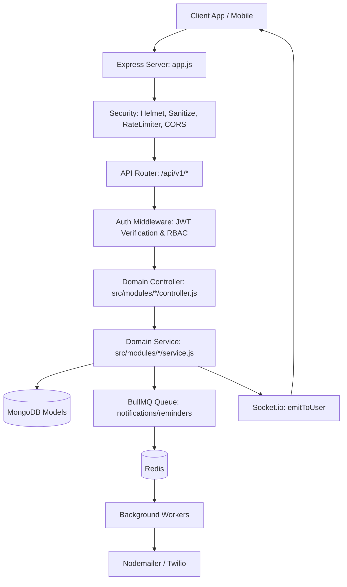

# MediSync — Backend Architecture & Folder Structure

## 1. Architectural Overview

MediSync backend is built as an enterprise-grade, modular Node.js/Express application implementing **Domain-Driven Modular Layering**. Each clinical and operational domain is self-contained with its own models, services, controllers, routes, and validation schemas.

### Core Architectural Pillars
- **Modular Monolith**: Clean separation by domain entity under `src/modules/`.
- **Strict Layering**: Request -> RateLimiter -> Auth & Role Middleware -> Input Validation -> Controller -> Domain Service -> Data Model (Mongoose).
- **Asynchronous Task Queue**: Decoupled BullMQ + Redis for background job execution (transactional email, SMS, cron appointment reminders).
- **Real-Time Event Engine**: Socket.io integrated with authenticated HTTP server for bi-directional live booking updates.
- **Defense-in-Depth Security**: Helmet, MongoDB injection sanitization, HPP parameter pollution protection, tiered rate-limiters, password hashing with bcrypt, JWT rotation with cryptographic token hashing.

---

## 2. Directory Tree

```
backend/
├── .env.example                     # Environment template with all required keys
├── .gitignore                       # Git ignore configuration
├── Dockerfile                       # Multi-stage production container definition
├── docker-compose.yml               # Multi-container orchestration (API, Mongo, Redis, Workers)
├── eslint.config.js                 # ESLint v9+ flat configuration
├── package.json                     # Scripts, dependencies, engines, Jest config
├── package-lock.json
├── MediSync.postman_collection.json # Comprehensive Postman API collection
├── MediSync.postman_environment.json# Postman environment variables
├── uploads/                         # Uploaded medical artifacts
│   └── reports/                     # Diagnostic test PDFs & images
├── logs/                            # Rotating log files in production
├── tests/                           # Integration and unit tests
│   ├── setup.js                     # Global test setup (in-memory Mongo, timeouts)
│   ├── helpers.js                   # Test user generation, auth helpers, supertest client
│   ├── auth.test.js                 # Authentication & authorization test suite
│   └── booking.test.js              # Booking & doctor availability test suite
└── src/
    ├── app.js                       # Express app configuration & middleware pipeline
    ├── server.js                    # HTTP server startup, DB connection, Socket.io attachment, graceful shutdown
    ├── config/                      # Infrastructure & runtime configs
    │   ├── env.js                   # Validated environment variables
    │   ├── db.js                    # Mongoose connection pooling & event listeners
    │   ├── redis.js                 # IORedis client configuration (conditional in test mode)
    │   └── swagger.js               # Swagger/OpenAPI 3.0 JSDoc configuration
    ├── middleware/                  # Reusable request processing middlewares
    │   ├── auth.js                  # JWT verification (protect, protectLoose)
    │   ├── role.js                  # Role-Based Access Control (restrictTo)
    │   ├── validate.js              # express-validator error formatting handler
    │   ├── rateLimiter.js           # Tiered express-rate-limiters (global, auth, password reset)
    │   ├── sanitize.js              # NoSQL injection & HTTP Parameter Pollution prevention
    │   ├── upload.js                # Multer disk/stream storage for medical reports
    │   ├── audit.js                 # Automated audit logging lifecycle interceptor
    │   └── error.js                 # Global error handling & 404 handler
    ├── utils/                       # Shared helpers and utilities
    │   ├── ApiError.js              # Operational API error class with status codes
    │   ├── catchAsync.js            # Async controller wrapper for unhandled promises
    │   ├── apiResponse.js           # Standardized JSON response envelope formatter
    │   ├── logger.js                # Winston logger with daily file rotation & dev colorizer
    │   └── tokens.js                # JWT sign/verify, SHA-256 token hashing, random byte generator
    ├── services/                    # Third-party integrations
    │   ├── mailer.js                # Nodemailer transport & HTML email templates
    │   └── sms.js                   # Twilio SMS client wrapper (lazy-loaded)
    ├── jobs/                        # Asynchronous BullMQ background subsystem
    │   ├── queues.js                # BullMQ queue instantiations (notifications, reminders)
    │   └── workers/
    │       ├── notification.worker.js # Asynchronous email/SMS dispatch worker
    │       └── reminder.worker.js     # Daily scheduled scan worker (cron at 9:00 AM)
    ├── sockets/
    │   └── index.js                 # Socket.io initialization, handshake JWT auth, user room routing
    ├── scripts/
    │   └── seedAdmin.js             # Initial system administrator bootstrap script
    └── modules/                     # Domain modules
        ├── auth/                    # Registration, verification, login, refresh rotation, password reset
        │   ├── auth.controller.js
        │   ├── auth.routes.js
        │   ├── auth.service.js
        │   └── auth.validation.js
        ├── user/                    # User profile, role isolation, `/me`, soft delete
        │   ├── user.controller.js
        │   ├── user.model.js
        │   ├── user.routes.js
        │   ├── user.service.js
        │   └── user.validation.js
        ├── doctor/                  # Doctor profiles, specialization, structured availability schedules, public directory
        │   ├── doctor.controller.js
        │   ├── doctor.model.js      # Rich schema: qualifications, rating, reviews, image, languages, availability
        │   ├── doctor.routes.js     # Public GET directory & protected admin mutations
        │   ├── doctor.service.js    # Search regex, department filtering, and auto-seeding
        │   └── doctor.validation.js
        ├── booking/                 # Appointments, schedule slot alignment, notifications & live socket events
        │   ├── booking.controller.js
        │   ├── booking.model.js
        │   ├── booking.routes.js
        │   ├── booking.service.js
        │   └── booking.validation.js
        ├── visit/                   # Clinical consultation encounters
        │   ├── visit.controller.js
        │   ├── visit.model.js
        │   ├── visit.routes.js
        │   ├── visit.service.js
        │   └── visit.validation.js
        ├── visitDisease/            # Clinical diagnosis & prescription records linked to visits
        │   ├── visitDisease.controller.js
        │   ├── visitDisease.model.js
        │   ├── visitDisease.routes.js
        │   ├── visitDisease.service.js
        │   └── visitDisease.validation.js
        ├── test/                    # Diagnostic lab tests & uploaded report attachments
        │   ├── test.controller.js
        │   ├── test.model.js
        │   ├── test.routes.js
        │   ├── test.service.js
        │   └── test.validation.js
        ├── refreshToken/            # Refresh token tracking with TTL auto-cleanup
        │   └── refreshToken.model.js
        ├── audit/                   # Compliance audit log tracking & administrative inspection
        │   ├── audit.model.js
        │   ├── audit.routes.js
        │   └── audit.router.js
        └── metrics/                 # Prometheus operational telemetry endpoint
            └── metrics.routes.js
```

---

## 3. Module Responsibilities & Flow



---

## 4. Database Models & Schema Relationships

| Model | Collection | Key Fields | Relationships |
| :--- | :--- | :--- | :--- |
| **User** | `users` | `name`, `email`, `mobile`, `password`, `role`, `status`, `emailVerified`, `failedLoginAttempts`, `lockUntil`, `deletedAt` | Referenced by RefreshToken, AuditLog, Visit, Booking |
| **RefreshToken** | `refreshtokens` | `user`, `tokenHash`, `userAgent`, `ip`, `expiresAt`, `revokedAt` | Belongs to `User` (Indexed TTL for auto purge) |
| **Doctor** | `doctors` | `name`, `email`, `mobile`, `specialization`, `qualifications`, `experience`, `hospital`, `languages`, `rating`, `reviewCount`, `image`, `nextAvailable`, `availability` (`[{ day, start, end, slotMinutes }]`), `user` | Optional 1:1 with `User`, referenced by Booking, Visit |
| **Booking** | `bookings` | `patient`, `doctor`, `date`, `time`, `status` (`pending`, `confirmed`, `cancelled`, `completed`) | References `User` (patient) and `Doctor` (compound unique slot index) |
| **Visit** | `visits` | `date`, `time`, `patient`, `doctor` | References `User` (patient) and `Doctor` |
| **VisitDisease**| `visitdiseases` | `visit`, `disease`, `prescription` | Belongs to `Visit` |
| **Test** | `tests` | `visit`, `visitDisease`, `testName`, `testDate`, `reportUrl`, `reportText`, `createdBy` | References `Visit`, optional `VisitDisease`, created by `User` |
| **AuditLog** | `auditlogs` | `actor`, `actorRole`, `action`, `entity`, `entityId`, `before`, `after`, `ip`, `userAgent` | Actor references `User` |

---

## 5. Security & Authentication Model

1. **Tokens**:
   - Short-lived Access Token (15m): Stateless JWT containing `{ id, type: 'access' }`.
   - Long-lived Refresh Token (30d): Random UUID (`jti`) stored hashed with SHA-256 in MongoDB. Rotated on every use. Revoked globally upon password reset or user logout.
2. **Account Lockout Protection**:
   - 10 consecutive failed password attempts trigger automatic temporary account lockout (30 minutes).
3. **Role-Based Access Control (RBAC)**:
   - `patient`: Can access own profile, manage own appointments, view own clinical records and test reports.
   - `doctor`: Can view assigned patients, visits, prescriptions, and diagnostic tests.
   - `receptionist`: Can create/manage appointments, check in visits, and upload test results.
   - `admin`: Full administrative control, user role management, system metrics, audit log inspection.
