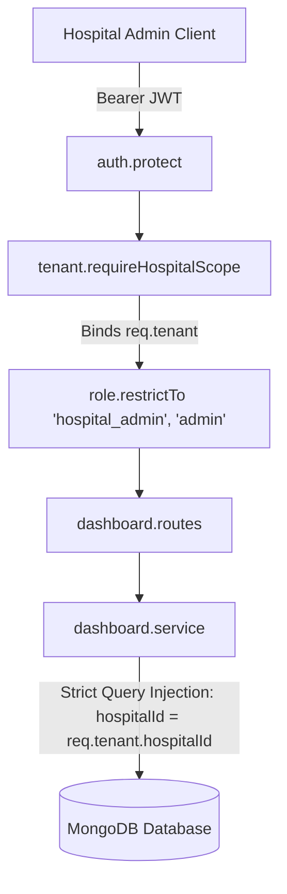

# MediSync — Milestone 4 Architecture & Requirements Specification
## Hospital Admin Dashboard & Operations Management

---

### 1. Executive Summary & Objective

**Milestone 4** establishes the **Hospital Admin Dashboard** in MediSync. In a multi-tenant healthcare SaaS ecosystem, each hospital administrator requires a centralized control center to oversee their specific facility's operations without exposure to or interference from other hospitals.

The primary objective of Milestone 4 is to provide hospital administrators with:
1. **Facility Overview**: Authoritative hospital metadata, accreditation status, contact information, and operational state.
2. **Aggregated Clinical & Operational Statistics**: Patient census, doctor directory status, receptionist staffing, and appointment volumes.
3. **Daily Operations Command**: Real-time view of today's appointments, doctor queues, and patient arrivals.
4. **Clinical Governance & Credentialing**: Workflow for reviewing, approving, or rejecting doctor registrations and qualifications before they can accept patients.
5. **Patient Queue Visibility**: Real-time waiting room and appointment status tracking for efficient front-desk coordination.
6. **Hospital-Scoped Audit Trail**: Tamper-evident operational activity logs isolated strictly to the administrator's facility.

---

### 2. Multi-Tenant Authorization & Security Boundaries

Milestone 4 strictly enforces the **Tenant Isolation Model** established in Milestone 3:



#### Invariant Rules:
1. **Server-Derived Tenant Scope**: All dashboard queries use `req.tenant.hospitalId` populated by `requireHospitalScope` from the authenticated user's validated account.
2. **Zero IDOR Vulnerability**: No client-supplied `hospitalId` in route parameters (`:hospitalId`), query parameters, or request bodies is permitted to override `req.tenant.hospitalId`.
3. **Cross-Tenant Hard Block**: A Hospital Admin attempting to query or mutate any record (Doctor, Patient, Booking, AuditLog) belonging to another hospital receives an immediate `403 Forbidden` response.
4. **Clinical Record Segregation**: Hospital administrators manage scheduling and administrative profiles. Deep clinical notes (`VisitDisease`, medical observations) remain restricted according to clinical privilege policies.

---

### 3. Data Model Audit & Relationships

| Entity | Primary Model | Tenant Key | Role in Milestone 4 Dashboard |
|---|---|---|---|
| **Hospital** | `Hospital` | `_id` | Core facility metadata (name, code, status, address, contact, email) |
| **User (Staff)** | `User` | `hospitalId` | Receptionist count, admin user profile, staff status (`active`, `pending`, `inactive`) |
| **Patient Registration** | `PatientHospital` | `hospital` | Localized patient registration, MRN (`medicalRecordNumber`), active patient census |
| **Global Patient** | `Patient` | Cross-tenant | Demographics (name, gender, age, blood group) linked via `PatientHospital.patient` |
| **Doctor** | `Doctor` | `hospitalId` | Doctor census, specializations, pending verification queue (`verificationStatus`, `isApproved`) |
| **Booking** | `Booking` | `hospital` | Today's appointments, queue status (`pending`, `confirmed`, `completed`, `cancelled`) |
| **Audit Log** | `AuditLog` | `hospitalId` | Operational activity history (staff invited, doctor approved, status toggles) |

---

### 4. API Endpoints Specification

All endpoints are mounted under `/api/v1/dashboard/hospital-admin` with middlewares: `protect`, `requireHospitalScope`, `restrictTo('hospital_admin', 'admin')`.

#### 4.1 Overview & Aggregate KPIs
- **Endpoint**: `GET /api/v1/dashboard/hospital-admin/overview`
- **Response Schema**:
  ```json
  {
    "success": true,
    "data": {
      "hospital": {
        "id": "6724a1...",
        "name": "Apollo Memorial Hospital",
        "code": "APOLLO-DELHI",
        "email": "contact@apollo.org",
        "contactNumber": "+91 11 2345 6789",
        "status": "active",
        "address": { "city": "New Delhi", "state": "Delhi", "country": "India" }
      },
      "statistics": {
        "patients": {
          "total": 450,
          "active": 438,
          "inactive": 12,
          "newThisMonth": 35
        },
        "doctors": {
          "total": 28,
          "active": 24,
          "inactive": 2,
          "pendingVerification": 2
        },
        "receptionists": {
          "total": 6,
          "active": 6
        },
        "todayAppointments": {
          "total": 42,
          "confirmed": 28,
          "pending": 6,
          "completed": 7,
          "cancelled": 1
        }
      }
    }
  }
  ```

#### 4.2 Today's Appointments & Real-Time Queue
- **Endpoint**: `GET /api/v1/dashboard/hospital-admin/today-appointments`
- **Query Params**: `status`, `doctorId`, `page`, `limit`
- **Description**: Returns all appointments scheduled for today within the hospital, populated with patient details (`name`, `mobile`, `medicalRecordNumber`) and doctor details (`name`, `specialization`).

#### 4.3 Pending Doctor Verifications
- **Endpoint**: `GET /api/v1/dashboard/hospital-admin/pending-doctors`
- **Description**: Lists all doctors assigned to this hospital where `verificationStatus` is `'pending_verification'` or `'under_review'`, or `isApproved` is `false`.
- **Action Endpoints**:
  - `PATCH /api/v1/doctors/:id/approve`: Verifies doctor credentials, sets `isApproved: true`, `isPublished: true`, and emits an audit event.
  - `PATCH /api/v1/doctors/:id/reject`: Rejects credentials with required `reason` string and emits an audit event.

#### 4.4 Patient Queue Summary
- **Endpoint**: `GET /api/v1/dashboard/hospital-admin/patient-queue`
- **Description**: Real-time listing of patients scheduled for consultation today, organized by doctor and estimated slot time, showing current consultation stage.

#### 4.5 Hospital Audit Trail
- **Endpoint**: `GET /api/v1/dashboard/hospital-admin/recent-activity`
- **Query Params**: `limit=20`
- **Description**: Most recent operational activities logged under `AuditLog` with `hospitalId = req.tenant.hospitalId`.

---

### 5. Frontend Architecture & Visual Layout

The Hospital Admin interface is accessible at `/admin/dashboard` and `/hospital-admin/dashboard`.

#### Component Structure:
```
frontend/src/pages/dashboard/admin/
├── index.jsx                  # Main Hospital Admin Dashboard Container
├── components/
│   ├── HospitalHeader.jsx     # Hospital identity banner & status pill
│   ├── StatCardGrid.jsx       # 4 KPI summary cards with micro-animations
│   ├── TodayScheduleTab.jsx   # Interactive appointment roster & queue filters
│   ├── DoctorApprovalTab.jsx  # Pending verification queue & review modal
│   ├── StaffManagementTab.jsx # Receptionist and doctor roster & invite trigger
│   ├── PatientRegistryTab.jsx # Hospital patients list with MRN search
│   └── ActivityFeedTab.jsx    # Hospital operational audit timeline
└── InviteStaff.jsx            # Staff invitation flow
```

#### Design Standards:
- Clean modern healthcare glassmorphism styling.
- Responsive grid (1-column mobile, 2-column tablet, 4-column desktop).
- Status badges:
  - Verified / Active: Emerald green (`bg-emerald-500/10 text-emerald-400 border-emerald-500/20`)
  - Pending / Under Review: Amber yellow (`bg-amber-500/10 text-amber-400 border-amber-500/20`)
  - Cancelled / Inactive: Rose red (`bg-rose-500/10 text-rose-400 border-rose-500/20`)
- Accessible ARIA labels and keyboard navigable modal controls.

---

### 6. Implementation Phasing

1. **Step 4.1 (Complete)**: Architecture & Requirements Audit and Specification Document.
2. **Step 4.2**: Backend Dashboard Module:
   - Create `backend/src/modules/dashboard/dashboard.service.js`
   - Create `backend/src/modules/dashboard/dashboard.controller.js`
   - Create `backend/src/modules/dashboard/dashboard.routes.js`
   - Register routes in `backend/src/app.js` at `/api/v1/dashboard`
3. **Step 4.3**: Unit & Integration Testing:
   - Create `backend/tests/hospitalAdminDashboard.test.js`
   - Validate 100% tenant isolation, aggregate accuracy, and doctor approval flow.
4. **Step 4.4**: Frontend Dashboard Enhancement:
   - Connect frontend to `/api/v1/dashboard/hospital-admin/overview`
   - Render live KPI stat cards, Today's Appointments tab, Doctor Verification tab, and Activity Feed.
5. **Step 4.5**: Verification & Gate Check:
   - Execute full test suite (`npm test`).
   - Validate live browser experience.
