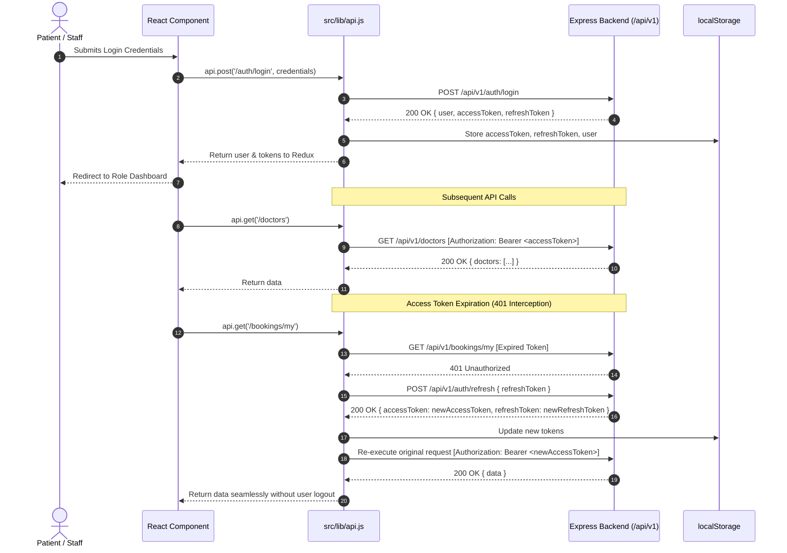

# MediSync — Frontend Architecture & Folder Structure

## 1. Architectural Overview

The MediSync frontend is an interactive, modern Single Page Application (SPA) built using **React 19**, **Vite**, **Tailwind CSS v4**, **Redux Toolkit**, and **React Router v7**. It follows a **Domain & Role-Based Modular Architecture** combined with responsive UI layouts and centralized state management.

### Core Architectural Pillars

- **Centralized Redux State Management**: Managed via Redux Toolkit (`src/store/slices/authSlice.js`) for session authentication, tokens, user profile, and role state.
- **Role-Based Access Control (RBAC)**: Custom `ProtectedRoute` guard evaluating user session authentication and permission arrays (`['patient', 'doctor', 'receptionist', 'admin']`).
- **Resilient Network Layer**: Centralized `apiClient` (`src/lib/api.js`) attaching Bearer JWT access tokens and automatically intercepting `401 Unauthorized` responses to execute silent token refresh against `POST /api/v1/auth/refresh`.
- **Global Design System**: Curated typography using Google Font **Plus Jakarta Sans** (weights 300–800) configured via Tailwind CSS v4 `@theme` and `@import` directives.
- **Backend API Reverse Proxy**: Vite development server proxying all `/api/*` traffic directly to the Express backend at `http://localhost:5000` to prevent CORS issues.

---

## 2. Complete Directory Tree

```
frontend/
├── index.html                   # HTML entry with Plus Jakarta Sans fonts, meta, and root mount
├── vite.config.js               # Vite configuration with React, Tailwind v4, and /api proxy
├── package.json                 # Scripts, dependencies (React 19, Redux Toolkit, React Router v7)
├── package-lock.json
├── eslint.config.js             # ESLint v9+ flat configuration with React hooks rules
├── public/                      # Static assets
│   ├── favicon.svg              # MediSync medical cross SVG icon
│   └── icons.svg                # Reusable SVG symbol defs
└── src/
    ├── main.jsx                 # Entry point mounting Redux <Provider> & React Router <RouterProvider>
    ├── App.jsx                  # Root layout shell with Header, dynamic Router <Outlet />, and Footer
    ├── index.css                # Tailwind CSS v4 @theme, Plus Jakarta Sans font, and base resets
    │
    ├── app/                     # Routing and application-level configuration
    │   └── routers.jsx          # Route definitions (public pages, auth routes, role-guarded portals)
    │
    ├── assets/                  # Bundled static media
    │   ├── hero.png             # Hero banner imagery
    │   ├── react.svg
    │   └── vite.svg
    │
    ├── components/              # Shared reusable components
    │   ├── auth/                # Authentication & authorization guards
    │   │   ├── ProtectedRoute.jsx   # Role guard verifying authentication & allowedRoles
    │   │   └── DashboardRedirect.jsx# Dynamic resolver redirecting /dashboard to role portal
    │   └── layout/              # Universal shell and layout components
    │       ├── header.jsx       # Top navigation, brand logo, role badges, and auth controls
    │       ├── navbar.jsx       # Responsive desktop links & animated mobile drawer menu
    │       └── footer.jsx       # Medical footer with two-tone logo, emergency desk, legal links
    │
    ├── hooks/                   # Custom reusable React hooks
    │   └── useDebounce.js       # Debouncing hook for live directory search & input filtering
    │
    ├── lib/                     # Utilities and network infrastructure
    │   └── api.js               # Centralized fetch wrapper, token injector & 401 silent refresh
    │
    ├── store/                   # Redux Toolkit centralized store
    │   ├── index.js             # configureStore root setup
    │   └── slices/
    │       └── authSlice.js     # loginUser, registerUser, logoutUser, role selectors & demo logins
    │
    └── pages/                   # Application page views
        ├── home/                # Landing page
        │   └── index.jsx        # Hero section, 24/7 metrics, clinical excellence, CTA
        ├── about/               # About MediSync
        │   └── index.jsx        # Mission, hospital metrics, core values, leadership board
        ├── services/            # Clinical Offerings
        │   └── index.jsx        # Specialized departments, clinical procedures, FAQ accordion
        ├── doctors/             # Medical Specialists Directory
        │   └── index.jsx        # Live backend search, specialty filtering, slot booking modal
        ├── contact/             # Contact & Emergency
        │   └── index.jsx        # 24/7 trauma numbers, clinic hours, contact inquiry form
        ├── auth/                # Authentication Pages
        │   ├── Login.jsx        # Sign-in form with validation, error banners, and 1-click role switcher
        │   ├── Register.jsx     # Patient registration with mobile, email, and password validation
        │   └── Unauthorized.jsx # 403 Access Denied guard page with role-aware redirection
        └── dashboard/           # Dedicated Role-Based Portals
            ├── patient/         # Patient Health Portal (/patient/dashboard)
            │   └── index.jsx    # Upcoming visits, virtual room link, prescriptions, lab reports
            ├── doctor/          # Physician Clinical Desk (/doctor/dashboard)
            │   └── index.jsx    # On-duty toggle, live patient queue, vitals, clinical note drawer
            ├── receptionist/    # Front Desk & Triage (/receptionist/dashboard)
            │   └── index.jsx    # Queue management, call token, status update, walk-in registration
            └── admin/           # Administrative Command Center (/admin/dashboard)
                └── index.jsx    # User role management, active/deactivate toggle, security audit log
```

---

## 3. Route Hierarchy & RBAC Access Matrix

```mermaid
graph TD
    Root["/ (App.jsx Root Shell)"] --> Public[Public Routes]
    Root --> AuthRoutes[Auth Routes]
    Root --> Protected[Role-Guarded Portals: ProtectedRoute]

    Public --> Home["/ (HomePage)"]
    Public --> Services["/services (ServicesPage)"]
    Public --> Doctors["/doctors (DoctorsPage)"]
    Public --> About["/about (AboutPage)"]
    Public --> Contact["/contact (ContactPage)"]

    AuthRoutes --> Login["/login (LoginPage)"]
    AuthRoutes --> Register["/register (RegisterPage)"]
    AuthRoutes --> Unauthorized["/unauthorized (403 Page)"]

    Protected --> DashRedirect["/dashboard (DashboardRedirect)"]
    Protected --> PatientPort["/patient/dashboard (PatientPortal)"]
    Protected --> DoctorPort["/doctor/dashboard (DoctorPortal)"]
    Protected --> RecepPort["/receptionist/dashboard (ReceptionistPortal)"]
    Protected --> AdminPort["/admin/dashboard (AdminPortal)"]
```



### Access Permission Matrix

| Route Path                  | Component                 | Allowed Roles                                        | Description                                                |
| :-------------------------- | :------------------------ | :--------------------------------------------------- | :--------------------------------------------------------- |
| `/`                       | `HomePage`              | Public                                               | Landing hero, services highlight, doctor CTA               |
| `/services`               | `ServicesPage`          | Public                                               | Departments, clinical procedures, FAQ accordion            |
| `/doctors`                | `DoctorsPage`           | Public                                               | Live MongoDB doctors directory, search, slot booking modal |
| `/about`                  | `AboutPage`             | Public                                               | Organization history, core values, board of directors      |
| `/contact`                | `ContactPage`           | Public                                               | Clinic location, 24/7 emergency line, message form         |
| `/login`                  | `LoginPage`             | Public                                               | Credential authentication with quick role switcher         |
| `/register`               | `RegisterPage`          | Public                                               | Patient account creation                                   |
| `/unauthorized`           | `UnauthorizedPage`      | Public / Auth                                        | 403 Access Denied explanation and redirect                 |
| `/dashboard`              | `DashboardRedirect`     | `patient`, `doctor`, `receptionist`, `admin` | Dynamic resolver routing user to appropriate portal        |
| `/patient/dashboard`      | `PatientDashboard`      | `patient`, `admin`                               | Appointments, virtual room link, lab test reports          |
| `/doctor/dashboard`       | `DoctorDashboard`       | `doctor`, `admin`                                | Clinical consultation queue, vitals, Rx notes              |
| `/receptionist/dashboard` | `ReceptionistDashboard` | `receptionist`, `admin`                          | Walk-in intake, token queue, doctor duty roster            |
| `/admin/dashboard`        | `AdminDashboard`        | `admin`                                            | Staff credentials, system metrics, security audit log      |

---

## 4. State Management (Redux Toolkit)

### `authSlice` (`src/store/slices/authSlice.js`)

| State Field         | Type              | Description                                                                     |
| :------------------ | :---------------- | :------------------------------------------------------------------------------ |
| `user`            | `Object \| null` | Authenticated user profile (`_id`, `name`, `email`, `role`, `status`) |
| `accessToken`     | `String \| null` | Current short-lived JWT access token                                            |
| `refreshToken`    | `String \| null` | Long-lived refresh token stored for auto-renewal                                |
| `isAuthenticated` | `Boolean`       | Computed status (`Boolean(accessToken && user)`)                              |
| `role`            | `String \| null` | User role (`patient`, `doctor`, `receptionist`, `admin`)                |
| `loading`         | `Boolean`       | Request pending indicator                                                       |
| `error`           | `String \| null` | Operational error message from API response                                     |

#### Async Actions & Thunks

- `loginUser({ email, password })`: Calls `POST /api/v1/auth/login`, stores tokens in `localStorage`, and commits user state.
- `registerUser({ name, mobile, email, password })`: Calls `POST /api/v1/auth/register` to register patient account.
- `fetchCurrentUser()`: Calls `GET /api/v1/users/me` using current Bearer token to sync session.
- `logoutUser()`: Calls `POST /api/v1/auth/logout`, purges `localStorage`, and resets auth state.
- `setMockSession(payload)`: Instant 1-click test drive helper for rapid role evaluation during development.

---

## 5. Network Communication & Token Lifecycle


