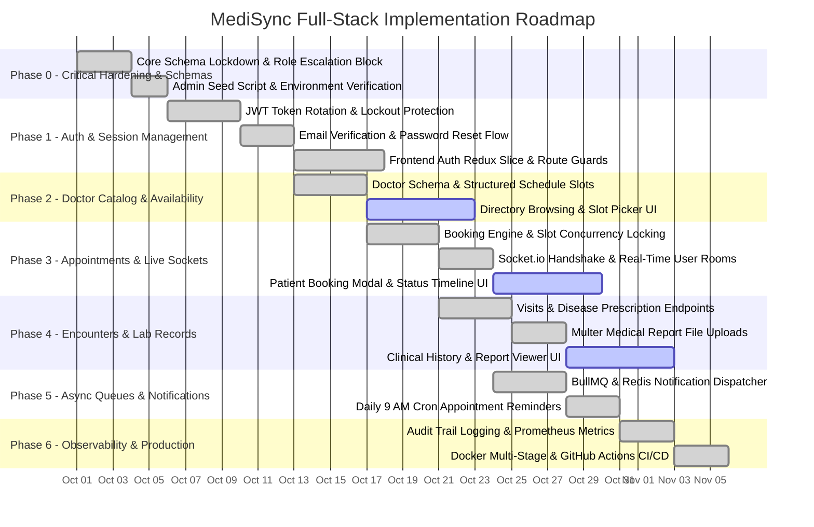

# MediSync — Full-Stack Implementation Plan & Roadmap

## 1. Executive Summary

MediSync is a secure, HIPAA/GDPR-conscious healthcare clinic management and appointment scheduling platform. This implementation plan organizes all development milestones into structured, actionable phases spanning **Backend Foundation**, **Frontend Portals**, **Real-Time Communication**, **Async Job Queues**, and **Production Deployment**.

---

## 2. Phase-by-Phase Roadmap



---

## 3. Phase Details & Deliverables

### Phase 0: Critical Fixes & Security Hardening (Delivered)

#### Objectives
- Ensure clean environment separation, bootstrap administrator credentials, and lock down core schema definitions.
- Prevent arbitrary role escalation and establish database index integrity.

#### Backend Deliverables
- [x] **Privilege Escalation Defense**: Hardcoded `role: 'patient'` default in registration service, ignoring incoming payload overrides.
- [x] **Bootstrap Seeding** ([seedAdmin.js](file:///d:/web_devlopment/classTraining/projects1/backend/src/scripts/seedAdmin.js)): Idempotent administrative user bootstrap script with verified status.
- [x] **Environment Validation** ([env.js](file:///d:/web_devlopment/classTraining/projects1/backend/src/config/env.js)): Fail-fast runtime verification of mandatory variables (`MONGODB_URI`, `JWT_SECRET`, `JWT_REFRESH_SECRET`).
- [x] **Schema Integrity**: Removed duplicate index warnings and corrected Mongoose 8 async pre-save hooks across all data models.

---

### Phase 1: Authentication, Authorization & Security Baseline

#### Objectives
- Prevent privilege escalation during registration.
- Provide secure credential storage and token lifecycles with refresh rotation.
- Establish baseline API security (rate limiting, NoSQL injection prevention, parameter pollution guards).

#### Backend Deliverables
- [x] **User Model** ([user.model.js](file:///d:/web_devlopment/classTraining/projects1/backend/src/modules/user/user.model.js)): Email, mobile, bcrypt hashing, lockout tracking (`failedLoginAttempts`, `lockUntil`).
- [x] **Refresh Token Model** ([refreshToken.model.js](file:///d:/web_devlopment/classTraining/projects1/backend/src/modules/refreshToken/refreshToken.model.js)): SHA-256 hashed token storage with MongoDB TTL expiration.
- [x] **Auth Service** ([auth.service.js](file:///d:/web_devlopment/classTraining/projects1/backend/src/modules/auth/auth.service.js)):
  - Enforced `role: 'patient'` on public registration.
  - Email verification link generation (24h expiry).
  - Password reset with crypto tokens (30m expiry).
  - Account lockout after 10 failed login attempts (30m lock).
  - Refresh token rotation (revoking previous token on issue).
- [x] **Security Middlewares**:
  - `protect` & `protectLoose` in [auth.js](file:///d:/web_devlopment/classTraining/projects1/backend/src/middleware/auth.js).
  - `restrictTo` RBAC in [role.js](file:///d:/web_devlopment/classTraining/projects1/backend/src/middleware/role.js).
  - Tiered rate-limiters in [rateLimiter.js](file:///d:/web_devlopment/classTraining/projects1/backend/src/middleware/rateLimiter.js).
  - In-place MongoDB injection sanitization & HPP in [sanitize.js](file:///d:/web_devlopment/classTraining/projects1/backend/src/middleware/sanitize.js).

#### Frontend Deliverables
- [x] **Redux Toolkit Integration**: Root store configured in [store/index.js](file:///d:/web_devlopment/classTraining/projects1/frontend/src/store/index.js) and wrapped into [main.jsx](file:///d:/web_devlopment/classTraining/projects1/frontend/src/main.jsx).
- [x] **Authentication Slice** ([authSlice.js](file:///d:/web_devlopment/classTraining/projects1/frontend/src/store/slices/authSlice.js)): Async thunks for `loginUser`, `registerUser`, `fetchCurrentUser`, `logoutUser`, plus quick 1-click test drive helper.
- [x] **Centralized API Client** ([api.js](file:///d:/web_devlopment/classTraining/projects1/frontend/src/lib/api.js)): Auto-attached Bearer tokens, token storage in `localStorage`, and transparent 401 refresh token interceptor.
- [x] **Auth UI Pages**: [Login.jsx](file:///d:/web_devlopment/classTraining/projects1/frontend/src/pages/auth/Login.jsx), [Register.jsx](file:///d:/web_devlopment/classTraining/projects1/frontend/src/pages/auth/Register.jsx), and [Unauthorized.jsx](file:///d:/web_devlopment/classTraining/projects1/frontend/src/pages/auth/Unauthorized.jsx).
- [x] **Role Guard & Route Protection**: [ProtectedRoute.jsx](file:///d:/web_devlopment/classTraining/projects1/frontend/src/components/auth/ProtectedRoute.jsx) and [DashboardRedirect.jsx](file:///d:/web_devlopment/classTraining/projects1/frontend/src/components/auth/DashboardRedirect.jsx) in [routers.jsx](file:///d:/web_devlopment/classTraining/projects1/frontend/src/app/routers.jsx).
- [x] **Role-Based Portals**:
  - Patient Portal ([patient/index.jsx](file:///d:/web_devlopment/classTraining/projects1/frontend/src/pages/dashboard/patient/index.jsx))
  - Doctor Desk ([doctor/index.jsx](file:///d:/web_devlopment/classTraining/projects1/frontend/src/pages/dashboard/doctor/index.jsx))
  - Reception Console ([receptionist/index.jsx](file:///d:/web_devlopment/classTraining/projects1/frontend/src/pages/dashboard/receptionist/index.jsx))
  - Admin Center ([admin/index.jsx](file:///d:/web_devlopment/classTraining/projects1/frontend/src/pages/dashboard/admin/index.jsx))

---

### Phase 2: Doctor Directory & Availability Scheduling

#### Objectives
- Enable doctors to declare structured weekly working hours (days, start/end time, slot duration in minutes).
- Validate appointment slots against doctor's active weekly roster.

#### Backend Deliverables
- [x] **Doctor Model** ([doctor.model.js](file:///d:/web_devlopment/classTraining/projects1/backend/src/modules/doctor/doctor.model.js)): Embedded `availability: [{ day, start, end, slotMinutes }]` and clinical fields (`qualifications`, `experience`, `rating`, `reviewCount`, `image`, `hospital`, `languages`).
- [x] **Doctor Routes** ([doctor.routes.js](file:///d:/web_devlopment/classTraining/projects1/backend/src/modules/doctor/doctor.routes.js)): Public `GET /` and `GET /:id` directory browsing, admin-restricted mutations.
- [x] **Doctor Service** ([doctor.service.js](file:///d:/web_devlopment/classTraining/projects1/backend/src/modules/doctor/doctor.service.js)): Case-insensitive search regex, department filtering, and auto-seeding.

#### Frontend Deliverables
- [x] **Live Directory Search** ([doctors/index.jsx](file:///d:/web_devlopment/classTraining/projects1/frontend/src/pages/doctors/index.jsx)): Live query execution to `/api/v1/doctors` with 300ms debouncing.
- [x] **Specialty & Department Filter**: Dynamic department pills with instant query parameter updates.
- [x] **Interactive Doctor Cards**: Responsive cards displaying portrait, experience, hospital facility, rating, next available slot, and spoken languages.

---

### Phase 3: Appointment Booking Engine & Live Synchronization

#### Objectives
- Prevent duplicate appointment bookings for the same doctor at the same timestamp.
- Provide real-time live status updates to patients and clinical staff.

#### Backend Deliverables
- [x] **Booking Model** ([booking.model.js](file:///d:/web_devlopment/classTraining/projects1/backend/src/modules/booking/booking.model.js)): Unique compound index `{ doctor: 1, date: 1, time: 1 }` with partial filter on active bookings (`pending`, `confirmed`).
- [x] **Booking Service** ([booking.service.js](file:///d:/web_devlopment/classTraining/projects1/backend/src/modules/booking/booking.service.js)):
  - Slot alignment and working-hour boundary validation.
  - Notification dispatch on status changes (`booking-confirmed`, `booking-cancelled`).
  - Real-time Socket.io dispatch: `emitToUser(patientId, 'booking:status', payload)`.
- [x] **Socket.io Handshake** ([sockets/index.js](file:///d:/web_devlopment/classTraining/projects1/backend/src/sockets/index.js)): Handshake authentication using JWT, joining room `user:<userId>`.

#### Frontend Deliverables
- [x] **Slot Booking Modal** ([doctors/index.jsx](file:///d:/web_devlopment/classTraining/projects1/frontend/src/pages/doctors/index.jsx)): Integrated dialog with time slot picker, symptoms notes, and submission to `POST /api/v1/bookings`.
- [x] **Immediate Confirmation Feedback**: Visual confirmation receipt with direct navigation to the Patient Portal.
- [ ] Connect WebSocket listener (`socket.io-client`) to update patient & receptionist appointments live.

---

### Phase 4: Clinical Encounters & Laboratory Records

#### Objectives
- Track patient visits, medical diagnoses, and prescription instructions.
- Enable upload and retrieval of diagnostic lab test files (PDFs, images).

#### Backend Deliverables
- [x] **Visit Model & Routes** ([visit.model.js](file:///d:/web_devlopment/classTraining/projects1/backend/src/modules/visit/visit.model.js), [visit.routes.js](file:///d:/web_devlopment/classTraining/projects1/backend/src/modules/visit/visit.routes.js)).
- [x] **VisitDisease Model & Routes** ([visitDisease.model.js](file:///d:/web_devlopment/classTraining/projects1/backend/src/modules/visitDisease/visitDisease.model.js), [visitDisease.routes.js](file:///d:/web_devlopment/classTraining/projects1/backend/src/modules/visitDisease/visitDisease.routes.js)).
- [x] **Test Model & Upload Middleware** ([test.model.js](file:///d:/web_devlopment/classTraining/projects1/backend/src/modules/test/test.model.js), [upload.js](file:///d:/web_devlopment/classTraining/projects1/backend/src/middleware/upload.js)): Multer storage with 10MB limit and MIME validation (`application/pdf`, `image/*`).

#### Frontend Deliverables
- [ ] Patient Clinical Records page displaying past visits and prescribed medications.
- [ ] Doctor Visit Entry form allowing entry of clinical findings, ICD-10 disease codes, and dosage instructions.
- [ ] Report Upload & Viewer component with inline PDF viewing and image lightbox.

---

### Phase 5: Asynchronous Queues & Automated Notification Workers

#### Objectives
- Offload transactional emails and SMS messages from HTTP request-response cycle.
- Automatically scan and dispatch appointment reminders 24 hours in advance.

#### Backend Deliverables
- [x] **BullMQ Queues** ([queues.js](file:///d:/web_devlopment/classTraining/projects1/backend/src/jobs/queues.js)): `notifications` and `reminders` queues backed by Redis with exponential backoff retries.
- [x] **Notification Worker** ([notification.worker.js](file:///d:/web_devlopment/classTraining/projects1/backend/src/jobs/workers/notification.worker.js)): Dispatches verification emails, reset password links, and appointment alerts via Nodemailer / Twilio.
- [x] **Reminder Worker** ([reminder.worker.js](file:///d:/web_devlopment/classTraining/projects1/backend/src/jobs/workers/reminder.worker.js)): Daily cron scan (`0 9 * * *`) identifying all confirmed bookings for the following day.

---

### Phase 6: Compliance, Observability & Production Deployment

#### Objectives
- Full administrative audit trail for security and medical compliance.
- Metrics endpoint for Prometheus and Grafana dashboards.
- Containerized multi-service deployment with automated CI/CD testing.

#### Deliverables
- [x] **Audit Logging** ([audit.model.js](file:///d:/web_devlopment/classTraining/projects1/backend/src/modules/audit/audit.model.js), [audit.js](file:///d:/web_devlopment/classTraining/projects1/backend/src/middleware/audit.js), [audit.routes.js](file:///d:/web_devlopment/classTraining/projects1/backend/src/modules/audit/audit.routes.js)).
- [x] **Prometheus Telemetry** ([metrics.routes.js](file:///d:/web_devlopment/classTraining/projects1/backend/src/modules/metrics/metrics.routes.js)).
- [x] **Swagger Documentation** ([swagger.js](file:///d:/web_devlopment/classTraining/projects1/backend/src/config/swagger.js) at `/api-docs`).
- [x] **Docker & Compose** ([Dockerfile](file:///d:/web_devlopment/classTraining/projects1/backend/Dockerfile), [docker-compose.yml](file:///d:/web_devlopment/classTraining/projects1/backend/docker-compose.yml)).
- [x] **GitHub Actions Workflow** ([ci.yml](file:///d:/web_devlopment/classTraining/projects1/.github/workflows/ci.yml)): Automating test runs and lint checks.

---

## 4. Verification & Testing Matrix

| Test Suite | File | Coverage Areas | Verification Command |
| :--- | :--- | :--- | :--- |
| **Authentication & RBAC** | [auth.test.js](file:///d:/web_devlopment/classTraining/projects1/backend/tests/auth.test.js) | Escalation block, email verification requirement, token issuance, refresh rotation, brute-force lockout | `npm test -- tests/auth.test.js` |
| **Doctor Availability & Booking** | [booking.test.js](file:///d:/web_devlopment/classTraining/projects1/backend/tests/booking.test.js) | Schedule alignment, slot intervals, multi-tenant patient isolation | `npm test -- tests/booking.test.js` |
| **Code Style & Quality** | [eslint.config.js](file:///d:/web_devlopment/classTraining/projects1/backend/eslint.config.js) | Static syntax analysis, unused variable elimination, import verification | `npm run lint` |
| **Admin Seed Verification** | [seedAdmin.js](file:///d:/web_devlopment/classTraining/projects1/backend/src/scripts/seedAdmin.js) | Initial admin initialization idempotency | `npm run seed:admin` |

---

## 5. Deployment Checklist

1. **Environment Preparation**:
   - Copy `.env.example` to `.env`.
   - Configure production MongoDB replica set URI (`MONGODB_URI`).
   - Configure Redis connection URL (`REDIS_URL`).
   - Supply distinct, cryptographically strong `JWT_SECRET` and `JWT_REFRESH_SECRET`.
   - Enter SMTP credentials and Twilio SID/Auth Tokens.
2. **Launch Services**:
   ```bash
   docker compose up -d --build
   ```
3. **Verify Health**:
   - HTTP Health Check: `GET /health` (returns `{ status: 'ok', uptime }`)
   - API Documentation: `GET /api-docs`
   - Prometheus Metrics: `GET /metrics`
