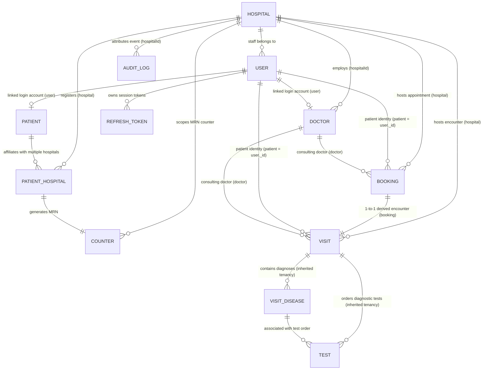

# MediSync — Step 3.5.2.1 Resource Ownership Architecture Inventory
**Milestone 3: Multi-Tenant Authorization & Hospital Isolation**  
**Mode: READ-ONLY AUDIT DELIVERABLE**  
**Generated Date:** 2026-10-31  

---

## Executive Summary

As part of **Step 3.5.2 (Multi-Tenant Isolation Audit)**, this inventory establishes the authoritative data-access boundaries, ownership models, and tenancy rules across the MediSync platform. Every database model, schema relationship, route, controller, service, and middleware in the backend (`d:/web_devlopment/classTraining/projects1/backend`) was inspected.

### Core Architecture Principles Discovered:
1. **Hospital is the Platform Tenant Entity:** Each hospital facility is an isolated tenancy boundary with its own staff, bookings, visits, medical record numbers, and clinical encounters.
2. **Patient Identity is Global:** `Patient` records hold platform-wide identity and medical background without a fixed `hospitalId`. Patient access to a specific hospital is strictly governed by the `PatientHospital` affiliation bridge.
3. **Staff is Hospital-Scoped:** Users with roles `hospital_admin`, `doctor`, and `receptionist` must have a non-null, valid `User.hospitalId` bound to an active `Hospital`.
4. **Clinical Records Inherit Ownership:** Models representing clinical encounter details (`VisitDisease`, `Test`) do not carry a direct `hospitalId` field; their tenancy and authorization are strictly inherited from their parent `Visit` (`Visit.hospital`).
5. **Doctor Has Dual Identity:** A `Doctor` document links to a `User` login account and binds directly to `Hospital` via `hospitalId` (authoritative ObjectId). A legacy field `hospital` (String) exists for display purposes and must never be used for authorization.

---

## Section A: Resource Ownership Matrix

| # | Model | Direct Hospital Field | Ownership Type | Parent Resource | Authoritative Tenancy Relationship | Roles & Access Policy | Relevant Indexes | Findings / Tenancy Status |
|---|-------|----------------------|----------------|-----------------|-----------------------------------|----------------------|------------------|---------------------------|
| 1 | **Hospital** | `_id` | **Root Tenant** | None | Self-governing tenant entity. | **Super Admin:** Full platform CRUD & status toggle.<br>**Public/Auth:** List and read details of active hospitals. | • `{ code: 1 }` (unique)<br>• `{ email: 1 }` (unique)<br>• `{ name: 1 }`<br>• `{ status: 1, deletedAt: 1 }` | Root platform entity. Active status & soft-deletion checked at boundary. |
| 2 | **User** | `hospitalId` | **Hybrid** (Staff: Scoped; SuperAdmin & Patient: Global) | `Hospital` (for staff) | `User.hospitalId` determines hospital tenancy for staff. `null` for `super_admin` and `patient`. | **Super Admin:** Manage platform users.<br>**Hospital Admin:** Manage staff of own hospital only.<br>**Doctor/Receptionist/Patient:** Read self profile (`/me`). | • `{ mobile: 1 }` (unique)<br>• `{ email: 1 }` (unique)<br>• `{ role: 1 }`<br>• `{ hospitalId: 1 }`<br>• `{ hospitalId: 1, role: 1 }`<br>• `{ hospitalId: 1, status: 1 }`<br>• `{ deletedAt: 1 }` | Properly isolated in `user.service.js`. Role escalation and cross-hospital assignment blocked. |
| 3 | **Doctor** | `hospitalId` *(Legacy: `hospital` String)* | **Direct Hospital-Scoped** | `Hospital` & `User` (`user` ref) | `Doctor.hospitalId` is the authoritative reference to `Hospital._id`. | **Public:** Browse active, verified, published doctors.<br>**Hospital Admin:** Approve/reject/manage doctors of own hospital.<br>**Doctor:** Update self credentials. | • `{ mobile: 1 }` (unique)<br>• `{ email: 1 }` (unique)<br>• `{ hospitalId: 1 }`<br>• `{ specialization: 1 }`<br>• `{ deletedAt: 1 }` | **Vulnerability:** `updateDoctor` and `deleteDoctor` lack hospital scoping.<br>**Bug:** `hospital.service.js` queries `Doctor` using string `hospital` instead of `hospitalId`. |
| 4 | **Patient** | *None* | **Global Identity** | `User` (1-to-1 ref) | Global identity across all hospitals. Hospital affiliation is managed via `PatientHospital`. | **Patient:** Access own profile only.<br>**Hospital Staff / Doctor:** Cannot access general patient directory without active `PatientHospital` affiliation. | • `{ user: 1 }` (unique sparse)<br>• `{ dateOfBirth: 1 }`<br>• `{ deletedAt: 1 }` | Global resource. Must NOT have direct `hospitalId` added. Requires relationship-based checks via `PatientHospital`. |
| 5 | **PatientHospital** | `hospital` | **Relationship Bridge** | `Patient` & `Hospital` | Many-to-many bridge linking global `Patient` to specific `Hospital`. Assigns scoped MRN. | **Hospital Staff / Doctor:** View patient list affiliated with their hospital.<br>**Patient:** Access records at affiliated facilities. | • `{ patient: 1, hospital: 1 }` (unique)<br>• `{ hospital: 1, medicalRecordNumber: 1 }` (unique)<br>• `{ hospital: 1, status: 1 }`<br>• `{ patient: 1 }`<br>• `{ hospital: 1 }` | Core multi-tenant bridge. Enforces unique patient affiliation and unique hospital-scoped MRN. |
| 6 | **Counter** | `hospital` | **Direct Hospital-Scoped** | `Hospital` | Hospital-specific counter for atomic, concurrency-safe MRN generation (`{HOSPITAL_CODE}-000001`). | Internal service only (`mrn.service.js`). | • `{ hospital: 1, key: 1 }` (unique)<br>• `{ hospital: 1 }` | Isolated per hospital. Concurrency safe via atomic `$inc` and upsert. |
| 7 | **Booking** | `hospital` | **Direct Hospital-Scoped** | `Hospital`, `Doctor`, `User` (patient) | Direct appointment booking at a specific hospital facility. | **Patient:** Book verified doctor affiliated with hospital; cancel own.<br>**Doctor:** View/update own appointments at assigned hospital.<br>**Staff:** Manage appointments for own hospital. | • `{ doctor: 1, date: 1, time: 1 }` (unique partial pending/confirmed)<br>• `{ hospital: 1, date: -1 }`<br>• `{ hospital: 1, status: 1 }`<br>• `{ patient: 1, date: -1 }` | Tenant-scoped in service. Note: `patient` references `User._id` directly. |
| 8 | **Visit** | `hospital` | **Direct Hospital-Scoped** | `Booking` (1-to-1), `Hospital`, `Doctor`, `User` | Clinical encounter derived directly and authoritatively from linked `Booking.hospital`. | **Receptionist / Admin:** Create visit for valid booking in same hospital; view metadata.<br>**Doctor:** Access visits where consulting doctor.<br>**Patient:** Access own visit history. | • `{ booking: 1 }` (unique)<br>• `{ hospital: 1, date: -1 }`<br>• `{ doctor: 1, date: -1 }`<br>• `{ patient: 1, date: -1 }` | 1-to-1 with Booking. Inherits hospital from Booking. Status and doctor hospital consistency strictly verified. |
| 9 | **VisitDisease** | *None* | **Inherited from Visit** | `Visit` (`visit` ref) | Clinical diagnosis and prescription for a visit encounter. Inherits hospital from `Visit.hospital`. | **Treating Doctor Only:** Record diagnoses and prescriptions.<br>**Patient:** View diagnoses from own consultations.<br>**Administrative Staff:** Strictly forbidden from clinical diagnoses. | • `{ visit: 1 }` | No direct `hospitalId`. Confidential clinical record. Access guarded via treating doctor care relationship. |
| 10 | **Test** | *None* | **Inherited from Visit** | `Visit` (`visit` ref), `VisitDisease` (optional) | Diagnostic lab test order and report. Inherits hospital from `Visit.hospital`. | **Doctor:** Order/view tests for encounters in doctor's hospital.<br>**Hospital Staff:** View test records for visits in their hospital.<br>**Patient:** Access tests for own visits. | • `{ visit: 1 }`<br>• `{ visitDisease: 1 }` | No direct `hospitalId`. Hospital affiliation validated via parent `Visit.hospital`. |
| 11 | **AuditLog** | `hospitalId` (nullable) | **Hospital-Attributed or Platform** | `Hospital` (optional), `User` (`actor`) | Security and operational event log. Scoped to hospital when action involves hospital resource/staff. | **Super Admin:** Query platform logs or filter by hospital.<br>**Hospital Admin:** Query logs where `hospitalId == admin.hospitalId` or `actor` belongs to staff of same hospital. | • `{ hospitalId: 1, createdAt: -1 }`<br>• `{ actor: 1, createdAt: -1 }`<br>• `{ entity: 1, entityId: 1, createdAt: -1 }` | Scoped via `$or` in `audit.routes.js`. Super Admin sees cross-hospital logs. |
| 12 | **RefreshToken** | *None* | **User-Scoped** | `User` (`user` ref) | Cryptographic token family for user session rotation. Tied to user account. | Auth service only (`auth.service.js`). | • `{ tokenHash: 1 }` (unique)<br>• `{ family: 1, revokedAt: 1 }`<br>• `{ user: 1, revokedAt: 1 }`<br>• `{ expiresAt: 1 }` (TTL) | Session-level credential. Not hospital-specific; inherits user identity. |

---

## Section B: Entity Relationship Diagram



---

## Section C: Route & Service Inventory

| Resource / Route | File Path | Operations Implemented | Authorized Roles | Tenant Derivation & Isolation Mechanism |
|------------------|-----------|------------------------|------------------|------------------------------------------|
| **Hospital**<br>`/api/v1/hospitals` | [hospital.routes.js](file:///d:/web_devlopment/classTraining/projects1/backend/src/modules/hospital/hospital.routes.js)<br>[hospital.service.js](file:///d:/web_devlopment/classTraining/projects1/backend/src/modules/hospital/hospital.service.js) | • `GET /stats/platform`<br>• `GET /`<br>• `GET /:id`<br>• `POST /`<br>• `PATCH /:id`<br>• `PATCH /:id/status` | • `super_admin`<br>• Public / OptionalAuth<br>• Public / OptionalAuth<br>• `super_admin`<br>• `super_admin`<br>• `super_admin` | Global platform administration. Only Super Admin can register or modify hospital entities. Public endpoints return active hospitals. |
| **User**<br>`/api/v1/users` | [user.routes.js](file:///d:/web_devlopment/classTraining/projects1/backend/src/modules/user/user.routes.js)<br>[user.service.js](file:///d:/web_devlopment/classTraining/projects1/backend/src/modules/user/user.service.js) | • `GET /me`<br>• `GET /`<br>• `GET /:id`<br>• `PATCH /:id`<br>• `DELETE /:id` | • Authenticated User<br>• `super_admin`, `hospital_admin`<br>• `super_admin`, `hospital_admin`, Self<br>• `super_admin`, `hospital_admin`, Self<br>• `super_admin`, `hospital_admin` | In `user.service.js`: `Hospital Admin` queries and mutations are hard-scoped to `filter.hospitalId = currentUser.hospitalId`. Cross-hospital updates and role promotions are strictly rejected with 403. |
| **Doctor**<br>`/api/v1/doctors` | [doctor.routes.js](file:///d:/web_devlopment/classTraining/projects1/backend/src/modules/doctor/doctor.routes.js)<br>[doctor.service.js](file:///d:/web_devlopment/classTraining/projects1/backend/src/modules/doctor/doctor.service.js) | • `GET /`<br>• `GET /:id`<br>• `PATCH /:id/credentials`<br>• `POST /`<br>• `PATCH /:id/approve`<br>• `PATCH /:id/reject`<br>• `PATCH /:id`<br>• `DELETE /:id` | • Public / OptionalAuth<br>• Public<br>• Doctor (Self), Admin<br>• `admin` / `hospital_admin`<br>• `admin`, `super_admin`, `hospital_admin`<br>• `admin`, `super_admin`, `hospital_admin`<br>• `admin`<br>• `admin` | • `GET /`: Scoped to `filter.hospitalId = actor.hospitalId` for `hospital_admin`.<br>• `approve`/`reject`: Strict hospital match between `actor.hospitalId` and `doctor.hospitalId`.<br>• **Gap:** `create`, `update`, `remove` do not check tenant boundary. |
| **Booking**<br>`/api/v1/bookings` | [booking.routes.js](file:///d:/web_devlopment/classTraining/projects1/backend/src/modules/booking/booking.routes.js)<br>[booking.service.js](file:///d:/web_devlopment/classTraining/projects1/backend/src/modules/booking/booking.service.js) | • `POST /`<br>• `GET /`<br>• `PATCH /:id/status` | • `patient`, `receptionist`, `hospital_admin`<br>• `patient`, `doctor`, `receptionist`, `hospital_admin`<br>• `patient`, `doctor`, `receptionist`, `hospital_admin` | • `POST /`: Patient must have active `PatientHospital` affiliation with doctor's hospital. Staff booking derives hospital strictly from `staffHospitalId`.<br>• `GET /`: Scoped to `patient` (self), `doctor` (assigned doctor & hospital), or staff (hospital doctors).<br>• `PATCH /:id/status`: Strict hospital & doctor ownership validated. |
| **Visit**<br>`/api/v1/visits` | [visit.routes.js](file:///d:/web_devlopment/classTraining/projects1/backend/src/modules/visit/visit.routes.js)<br>[visit.service.js](file:///d:/web_devlopment/classTraining/projects1/backend/src/modules/visit/visit.service.js) | • `POST /`<br>• `GET /`<br>• `GET /:id` | • `receptionist`, `hospital_admin`<br>• `patient`, `doctor`, `receptionist`, `hospital_admin`<br>• `patient`, `doctor`, `receptionist`, `hospital_admin` | • `POST /`: Hospital strictly derived from linked `Booking.hospital`. Staff, doctor, and booking hospital must match.<br>• `GET /`: Scoped to `patient` (self), `doctor` (consulting doctor & current hospital), or staff (`filter.hospital = staffHospitalId`).<br>• `GET /:id`: Post-query authorization checks hospital match. |
| **VisitDisease**<br>`/api/v1/visit-diseases` | [visitDisease.routes.js](file:///d:/web_devlopment/classTraining/projects1/backend/src/modules/visitDisease/visitDisease.routes.js)<br>[visitDisease.service.js](file:///d:/web_devlopment/classTraining/projects1/backend/src/modules/visitDisease/visitDisease.service.js) | • `POST /`<br>• `GET /` | • `doctor` (verified)<br>• `patient`, `doctor` | • `POST /`: Only treating doctor of the parent `Visit` can create diagnoses.<br>• `GET /`: Patient sees own visits; Doctor sees consultations where they are the consulting doctor.<br>• Administrative staff (Receptionist, Super Admin, Hospital Admin) denied access to private clinical records. |
| **Test**<br>`/api/v1/tests` | [test.routes.js](file:///d:/web_devlopment/classTraining/projects1/backend/src/modules/test/test.routes.js)<br>[test.service.js](file:///d:/web_devlopment/classTraining/projects1/backend/src/modules/test/test.service.js) | • `POST /`<br>• `GET /` | • `doctor` (verified)<br>• `patient`, `doctor`, `hospital_admin`, `receptionist`, `super_admin` | • `POST /`: Verified treating doctor at the encounter hospital creates test order.<br>• `GET /`: Scoped to patient's own visits, doctor's accessible visits at their hospital, or staff visits at their `user.hospitalId`. |
| **Audit Log**<br>`/api/v1/audit` | [audit.routes.js](file:///d:/web_devlopment/classTraining/projects1/backend/src/modules/audit/audit.routes.js) | • `GET /` | • `super_admin`, `hospital_admin` | • `super_admin`: Can query platform-wide logs or filter by `hospitalId`.<br>• `hospital_admin`: Filtered by `$or: [{ hospitalId: admin.hospitalId }, { actor: { $in: hospitalStaffIds } }]`. |
| **Auth & Invitation**<br>`/api/v1/auth` | [auth.routes.js](file:///d:/web_devlopment/classTraining/projects1/backend/src/modules/auth/auth.routes.js)<br>[auth.service.js](file:///d:/web_devlopment/classTraining/projects1/backend/src/modules/auth/auth.service.js) | • `POST /register`<br>• `POST /login`<br>• `POST /invite-staff`<br>• `POST /accept-invitation` | • Public<br>• Public<br>• `super_admin`, `hospital_admin`<br>• Public (Token-based) | • Staff invitation binds invited staff strictly to inviter's `hospitalId` (or target hospital for Super Admin).<br>• Public registration strictly sets `role: 'patient'` and creates linked `Patient` profile. |

---

## Section D: Categorized Architectural Findings

### 1. Critical Priority

#### Finding CRIT-01: Unprotected Write-Path in Doctor Updates and Deletion
- **Location:** [doctor.service.js:L214-221](file:///d:/web_devlopment/classTraining/projects1/backend/src/modules/doctor/doctor.service.js#L214-L221), [doctor.service.js:L267-271](file:///d:/web_devlopment/classTraining/projects1/backend/src/modules/doctor/doctor.service.js#L267-L271), [doctor.controller.js:L22-25](file:///d:/web_devlopment/classTraining/projects1/backend/src/modules/doctor/doctor.controller.js#L22-L25), [doctor.routes.js:L20-21](file:///d:/web_devlopment/classTraining/projects1/backend/src/modules/doctor/doctor.routes.js#L20-L21)
- **Description:** `updateDoctor(id, updates)` and `deleteDoctor(id)` do not accept the authenticated actor or verify `doctor.hospitalId`. In `doctor.controller.js`, `update` passes `req.params.id` and `req.body` directly to `Doctor.findByIdAndUpdate(id, updates)`.
- **Impact:** An administrator from Hospital A could provide the ObjectId of a doctor belonging to Hospital B in the URL and modify that doctor's profile, qualifications, status, or even change `hospitalId` to hijack the doctor profile. Furthermore, an admin can delete Hospital B's doctors.

#### Finding CRIT-02: Missing Tenant Validation on Doctor Creation
- **Location:** [doctor.controller.js:L7-10](file:///d:/web_devlopment/classTraining/projects1/backend/src/modules/doctor/doctor.controller.js#L7-L10), [doctor.service.js:L105-132](file:///d:/web_devlopment/classTraining/projects1/backend/src/modules/doctor/doctor.service.js#L105-L132)
- **Description:** `createDoctor(data)` accepts `data.hospitalId` directly from `req.body` without verifying that the creating administrator's `hospitalId` matches the doctor's assigned hospital.
- **Impact:** A Hospital Admin could create a doctor profile assigned to another hospital.

---

### 2. High Priority

#### Finding HIGH-01: Legacy Field Mismatch in Hospital Service Queries
- **Location:** [hospital.service.js:L80](file:///d:/web_devlopment/classTraining/projects1/backend/src/modules/hospital/hospital.service.js#L80), [hospital.service.js:L128](file:///d:/web_devlopment/classTraining/projects1/backend/src/modules/hospital/hospital.service.js#L128)
- **Description:** `hospital.service.js` queries `Doctor` using the legacy field name `hospital`:
  ```javascript
  Doctor.aggregate([
    { $match: { hospital: { $in: hospitalIds } } },
    { $group: { _id: '$hospital', count: { $sum: 1 } } },
  ])
  ```
  and
  ```javascript
  Doctor.find({ hospital: hospitalId }).select('name specialization email mobile verificationStatus isPublished isApproved')
  ```
- **Impact:** In `Doctor.model.js`, `hospital` is a legacy string (`'MediSync Main Hospital'`), while the authoritative reference is `hospitalId` (ObjectId). Aggregations and queries matching on `{ hospital: hospitalId }` will fail to match properly migrated doctors, yielding incorrect doctor counts and empty doctor lists in hospital management dashboards.

#### Finding HIGH-02: Cross-Hospital Care History Leak in Doctor VisitDisease Queries
- **Location:** [visitDisease.service.js:L44-45](file:///d:/web_devlopment/classTraining/projects1/backend/src/modules/visitDisease/visitDisease.service.js#L44-L45)
- **Description:** In `getVisitDiseases`, when the user is a doctor, accessible visits are resolved with:
  ```javascript
  const doctorVisits = await Visit.find({ doctor: doctorProfile._id }).select('_id');
  ```
  Unlike `visit.service.js` (lines 149-154), this query does NOT filter by `hospital: doctorProfile.hospitalId`.
- **Impact:** If a doctor relocates from Hospital A to Hospital B, querying `/api/v1/visit-diseases` could return clinical diagnosis records from the doctor's historical visits at Hospital A, violating Hospital A's clinical confidentiality.

#### Finding HIGH-03: Inconsistent Hospital Reference Field Naming Across Models
- **Location:** Multiple schemas.
- **Description:**
  - `hospitalId` (ObjectId): `User`, `Doctor`, `AuditLog`.
  - `hospital` (ObjectId): `Booking`, `Visit`, `PatientHospital`, `Counter`.
  - `hospital` (String, legacy): `Doctor.hospital`.
- **Impact:** High probability of developer error where queries use `hospitalId` on a `Booking`/`Visit` or `hospital` on a `User`/`Doctor`, resulting in silent query misses or accidental bypass of tenant scoping.

---

### 3. Medium Priority

#### Finding MED-01: Disconnected `requireHospitalScope` Tenant Middleware
- **Location:** [tenant.middleware.js:L18-64](file:///d:/web_devlopment/classTraining/projects1/backend/src/middleware/tenant.middleware.js#L18-L64)
- **Description:** `requireHospitalScope` validates that staff accounts belong to an active, verified hospital and sets `req.tenant = { hospitalId, hospitalName, hospitalCode }`. Although tested in `tests/tenant.test.js`, this middleware is **not mounted on any route** in `src/app.js` or `src/modules/*/*.routes.js`.
- **Impact:** Routes rely entirely on services doing inline fallbacks (`const staffHospitalId = tenant?.hospitalId || user.hospitalId`). Because `req.tenant` is never attached, `req.tenant` is always `undefined` at runtime.

#### Finding MED-02: Receptionist Omitted from Tenant Scope Filter in Doctor Directory
- **Location:** [doctor.service.js:L154-177](file:///d:/web_devlopment/classTraining/projects1/backend/src/modules/doctor/doctor.service.js#L154-L177)
- **Description:** Line 154 includes `receptionist` in `isStaffOrAdmin` (allowing them to pass `includeUnpublished=true` or query unpublished/pending doctors), but line 175 only applies the tenant filter if `actor.role === 'hospital_admin'`:
  ```javascript
  if (actor && actor.role === 'hospital_admin' && actor.hospitalId) {
    filter.hospitalId = actor.hospitalId;
  }
  ```
- **Impact:** A receptionist from Hospital A querying `/api/v1/doctors?includeUnpublished=true` can view unverified, pending, or rejected doctors from Hospital B.

#### Finding MED-03: Missing Compound Index for Doctor Tenancy Queries
- **Location:** [doctor.model.js:L49-51](file:///d:/web_devlopment/classTraining/projects1/backend/src/modules/doctor/doctor.model.js#L49-L51)
- **Description:** `Doctor` has `{ hospitalId: 1 }` and `{ specialization: 1 }`, but lacks compound indexes such as `{ hospitalId: 1, status: 1 }` or `{ hospitalId: 1, verificationStatus: 1, isApproved: 1 }`.
- **Impact:** Performance degradation as hospital staff directories and booking queries scale.

---

### 4. Low & Informational Observations

#### Finding LOW-01: Dual Representation of Patient Reference in Clinical Models
- **Location:** [booking.model.js:L5](file:///d:/web_devlopment/classTraining/projects1/backend/src/modules/booking/booking.model.js#L5), [visit.model.js:L4](file:///d:/web_devlopment/classTraining/projects1/backend/src/modules/visit/visit.model.js#L4), [patientHospital.model.js:L7](file:///d:/web_devlopment/classTraining/projects1/backend/src/modules/patientHospital/patientHospital.model.js#L7)
- **Description:** `Booking.patient` and `Visit.patient` store `User._id` (with `ref: 'User'`), whereas `PatientHospital.patient` stores `Patient._id` (with `ref: 'Patient'`). Services frequently perform dual resolution (`Patient.findOne({ _id }) || Patient.findOne({ user: _id })`).
- **Observation:** While functional, this duality requires explicit resolution logic across all authorization helpers (`patientAccess.service.js`, `clinicalAccess.service.js`).

#### Finding INFO-01: Legacy String Field `Doctor.hospital` Must Not Be Used
- **Location:** [doctor.model.js:L22](file:///d:/web_devlopment/classTraining/projects1/backend/src/modules/doctor/doctor.model.js#L22)
- **Description:** `Doctor.hospital` has a default value `'MediSync Main Hospital'`. This is a legacy display string from pre-multi-tenant versions. It must never be used for security boundaries or query filtering.

---

## Section E: Next-Step Recommendations for Step 3.5.2.2 (MongoDB Query Isolation Audit)

For **Step 3.5.2.2**, the following specific query paths and methods should be targeted for detailed query isolation verification:

1. **Doctor Query Audit:**
   - Audit `Doctor.findByIdAndUpdate` in `updateDoctor` and `deleteDoctor` ([doctor.service.js](file:///d:/web_devlopment/classTraining/projects1/backend/src/modules/doctor/doctor.service.js)).
   - Verify `Doctor.find(filter)` in `getAllDoctors` for all roles (`receptionist`, `doctor`, `hospital_admin`).
   - Audit `Doctor.aggregate` and `Doctor.find` in `hospital.service.js` to ensure migration to `hospitalId`.

2. **Booking & Visit Query Audit:**
   - Audit `Booking.findById` in `updateBookingStatus` to ensure tenant scoping is performed at the query layer (`Booking.findOne({ _id, hospital: staffHospitalId })`) rather than in memory after retrieving foreign records.
   - Audit `Visit.findById` in `getVisitById` ([visit.service.js](file:///d:/web_devlopment/classTraining/projects1/backend/src/modules/visit/visit.service.js)) to evaluate query-level isolation vs post-fetch validation.

3. **Clinical Records Query Audit (`VisitDisease` & `Test`):**
   - Audit `VisitDisease.find(filter)` in `getVisitDiseases` to ensure doctors cannot query historical visits from prior hospital affiliations.
   - Audit `Test.find(filter)` in `getTests` to ensure hospital staff cannot pass an arbitrary `query.visit` from another hospital.

4. **AuditLog Query Audit:**
   - Verify that the `$or` query filter in `audit.routes.js` cannot be bypassed through query parameter pollution or missing `hospitalId`.
